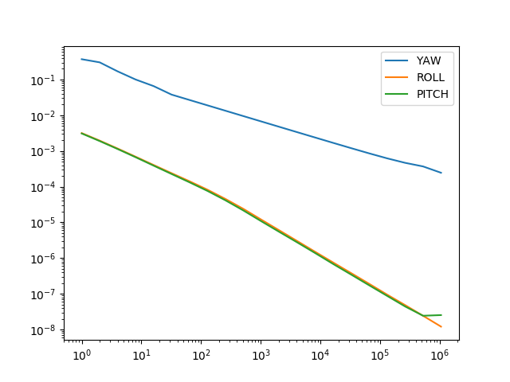
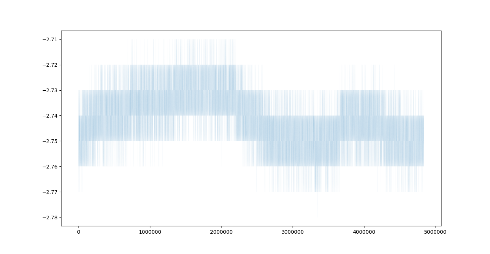
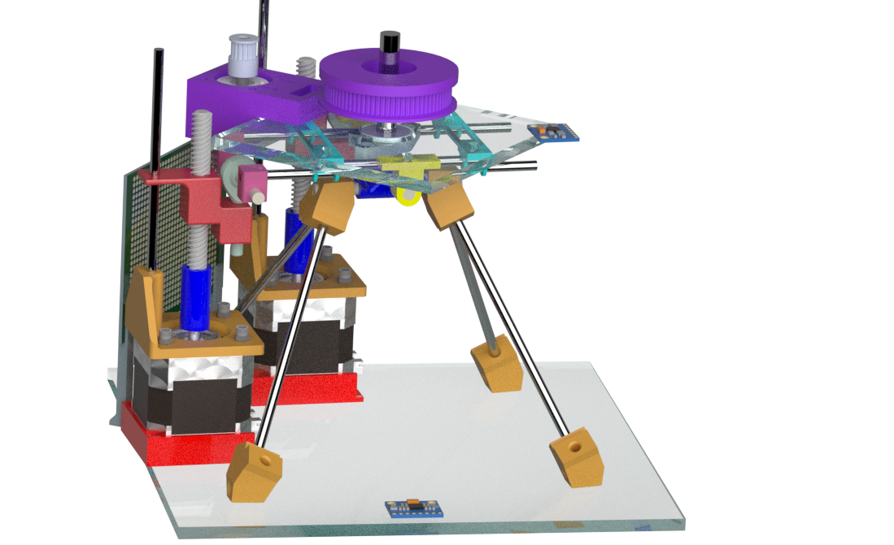

# ME407: Automatic Leveling and Targeting Platform

A desktop device that levels its own top plate and points a laser at a stored target, steered from a handheld wireless remote. It was our team project for METU ME407 Mechanical Engineering Design (Group A2, spring 2020). The semester moved online, and we built the device at home.

## What it does

- Two NEMA 17 steppers on TR8 lead screws tilt the top plate in roll and pitch until an MPU6050 motion sensor reads level.
- A NEMA 11 turns the laser stage through a GT2 belt with a 16 to 80 tooth reduction.
- A handheld remote (joystick, 4-digit display) sends commands over a 2.4 GHz nRF24L01 link, and the platform sends the target angle back.
- An 8-digit display on the base shows the incline of the surface the device stands on.
- Size 184 x 184 x 180 mm, mass 1.7 kg. The team's final presentation reports about 0.025° leveling accuracy, under 0.02° repeatability and a 15 s leveling time. This repository holds no test log for those three figures.

## Repository layout

| Folder | Contents |
|---|---|
| [`firmware/`](firmware/) | The five sketches that run the final device (see below). |
| [`firmware/dev/`](firmware/dev/) | Development and test sketches: sensor tests, the first 433 MHz radio pair, 2.4 GHz link tests, calibration, stepper trials. |
| [`hardware/step/`](hardware/step/) | STEP models of the custom parts and the assembly structure (Siemens NX 11 export, 2020-05-25). |
| [`hardware/drawings/`](hardware/drawings/) | Manufacturing drawings with GD&T for the acrylic plates and the shafts. |
| [`hardware/cam/`](hardware/cam/) | NX CAM G-code for the acrylic plates and the wooden CNC fixture. Files named `sabun` are dry runs cut in soap before the acrylic. |
| [`hardware/`](hardware/) | `BOM.xlsx` (parts, print and machining time) and `cost.xlsx` (cost model). |
| [`docs/electronics.md`](docs/electronics.md) | Block diagram, pin assignments for every board, power and photos. |
| [`tools/`](tools/) | MPU6050 orientation viewer (Processing), timelapse maker, Allan-deviation script. |
| [`data/drift_logs/`](data/drift_logs/) | Two zipped overnight and daytime sensor logs (May 2020). |

## Firmware

| Sketch | Runs on | Role |
|---|---|---|
| [`MPU6050_DMP6`](firmware/MPU6050_DMP6/MPU6050_DMP6.ino) | ATmega328 #1 | Leveling controller: reads roll and pitch, sets direction, enable and coarse/fine lines per axis. |
| [`steppperNEW`](firmware/steppperNEW/steppperNEW.ino) | ATmega328 #2 | Step-pulse generator for the two A4988 drivers. |
| [`7segment_8digit_MAX`](firmware/7segment_8digit_MAX/7segment_8digit_MAX.ino) | ATmega328 #3 | Incline display on an 8-digit MAX7219 module. |
| [`Remote_Reciever_2.4ghz`](firmware/Remote_Reciever_2.4ghz/Remote_Reciever_2.4ghz.ino) | ATmega328 #4 | Yaw stage: receives commands, drives the NEMA 11, returns the angle. |
| [`Remote_Transmitter_2.4ghz`](firmware/Remote_Transmitter_2.4ghz/Remote_Transmitter_2.4ghz.ino) | Arduino Nano | Handheld remote: joystick, button and 4-digit display. |

Build with the Arduino IDE. The ATmega328 chips run standalone at 16 MHz (Arduino Uno settings). Libraries: I2Cdev and MPU6050 from i2cdevlib, AccelStepper, RadioHead (RH_NRF24, RH_ASK, RHReliableDatagram), TM1637Display, Wire and SPI. Wiring is in [`docs/electronics.md`](docs/electronics.md).

## Sensor drift tests

In May 2020 the MPU6050 logged its angles through a day and a night while standing still (sketch [`MPU6050_DMP6_leonardo_TEST`](firmware/dev/MPU6050_DMP6_leonardo_TEST/MPU6050_DMP6_leonardo_TEST.ino)). [`tools/allan_deviation.py`](tools/allan_deviation.py) reads a log of `yaw!roll!pitch` lines and plots the overlapping Allan deviation per axis with allantools.

| | |
|---|---|
|  |  |
| Overlapping Allan deviation (degrees) against averaging window (samples). Roll and pitch fall from about 3e-3 to 1e-8 degrees; yaw, which has no absolute reference, falls from about 0.4 to 2e-4 degrees. | Roll angle (degrees) over about 4.8 million samples of a static log. It stays between -2.71 and -2.78 degrees. |

## Hardware notes

- The STEP files cover the parts we designed. Purchased parts (steppers, drivers, sensor and display modules, GT2 pulleys, lead screws and nuts, fasteners) are not included, so the assemblies open with those parts missing.
- Acrylic plates were cut with the NX CAM programs in `hardware/cam/` on a fixture plate. Brackets, adaptors and the motor mounts were 3D printed in PLA.
- The native NX parts (about 230 files) and the full STL set are kept offline.

## History

- 2020-03: concept sketches, the first breadboard tests and the NX layout (REV1).
- 2020-04: breadboard and perfboard prototype, a 2580-frame timelapse of it running, the first 433 MHz remote, and the firmware in this repository's first ten commits.
- 2020-05: sensor drift tests and the manufacturing package with STEP files and drawings (REV2 to REV3).
- 2020-06: the 2.4 GHz remote and receiver, the final firmware, the report and the final presentation.
- 2026-10: the June firmware, hardware, electronics notes and drift data were added from local copies.

## Team and credits

Group A2 was six students. Mert Senkardesler did the mechanical design in Siemens NX (REV1 to REV3 and the drawings), the firmware in this repository, the electronics, the drift tests and the CAM programs.

Third-party code inside this repository keeps its authors' terms:

- i2cdevlib by Jeff Rowberg (MIT licence): `MPU6050_DMP6` and the sketches derived from it, and `tools/MPUTeapot`.
- The MPU6050 calibration sketch by Luis Ródenas, built on i2cdevlib: `firmware/dev/mpuCALIBRATE`.
- RadioHead examples by Mike McCauley: the base of the radio sketches.
- The DroneBot Workshop nRF24L01 joystick demo: the base of `Remote_Transmitter_2.4ghz` and the 2.4 GHz link tests.
- The HowToMechatronics MPU6050 example: `firmware/dev/gyro_ARDU`.
- A video helper class from Coding For Entrepreneurs: `tools/timelapseMaker.py`.
