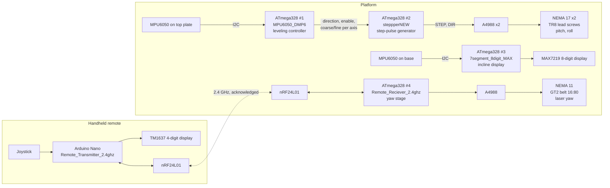
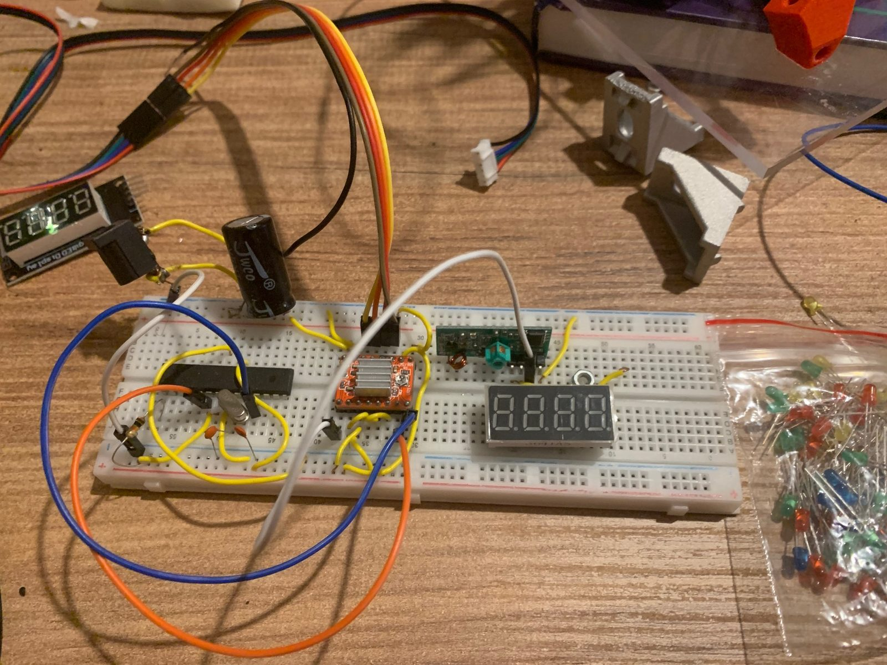
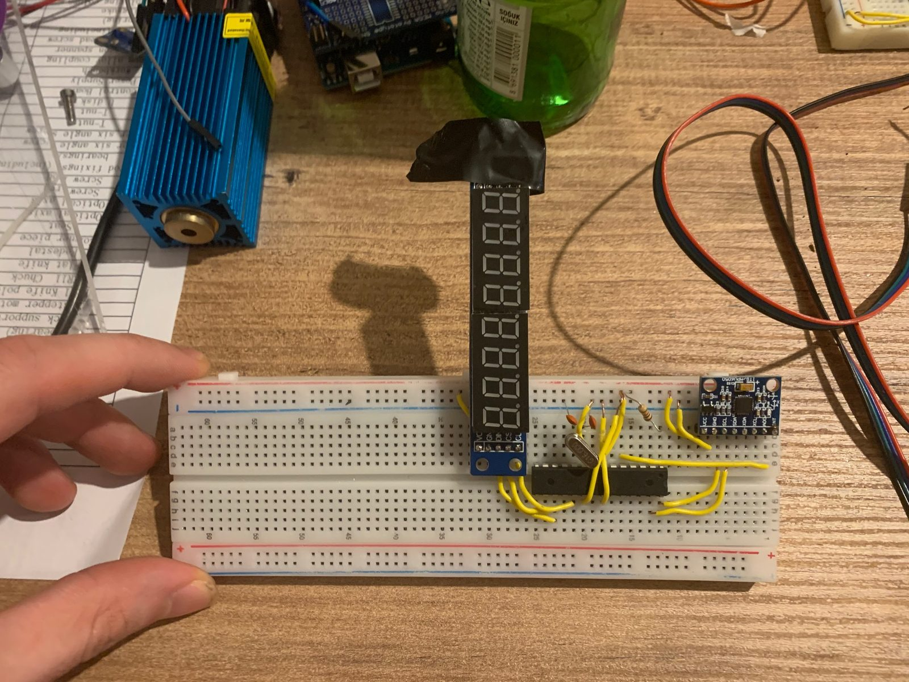
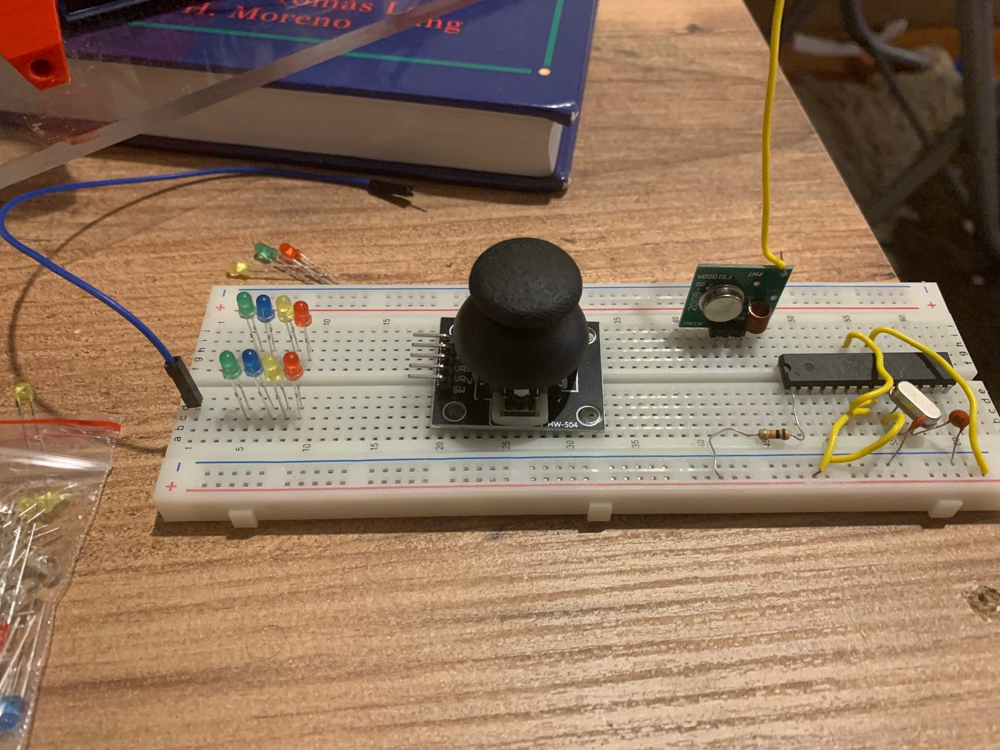
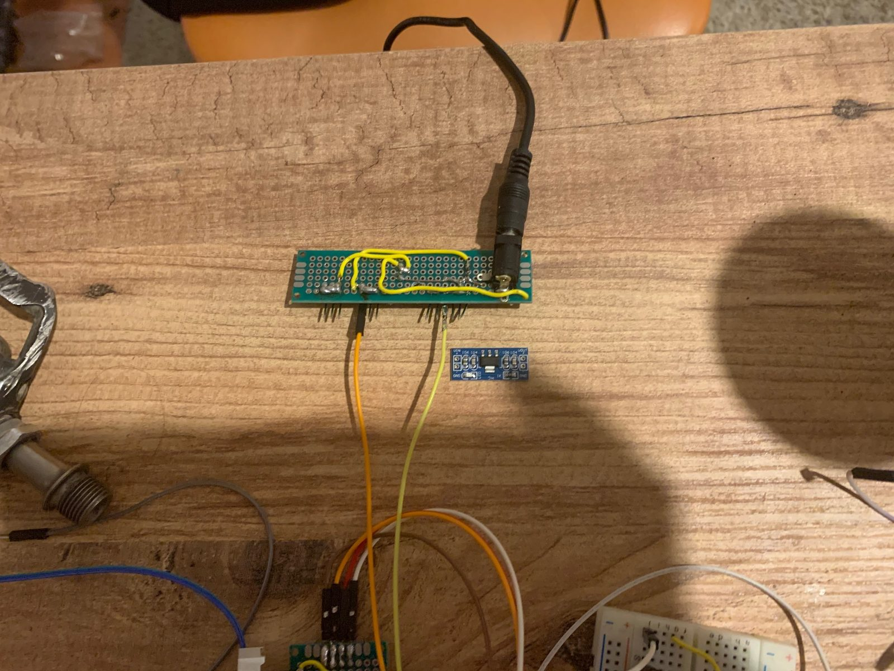
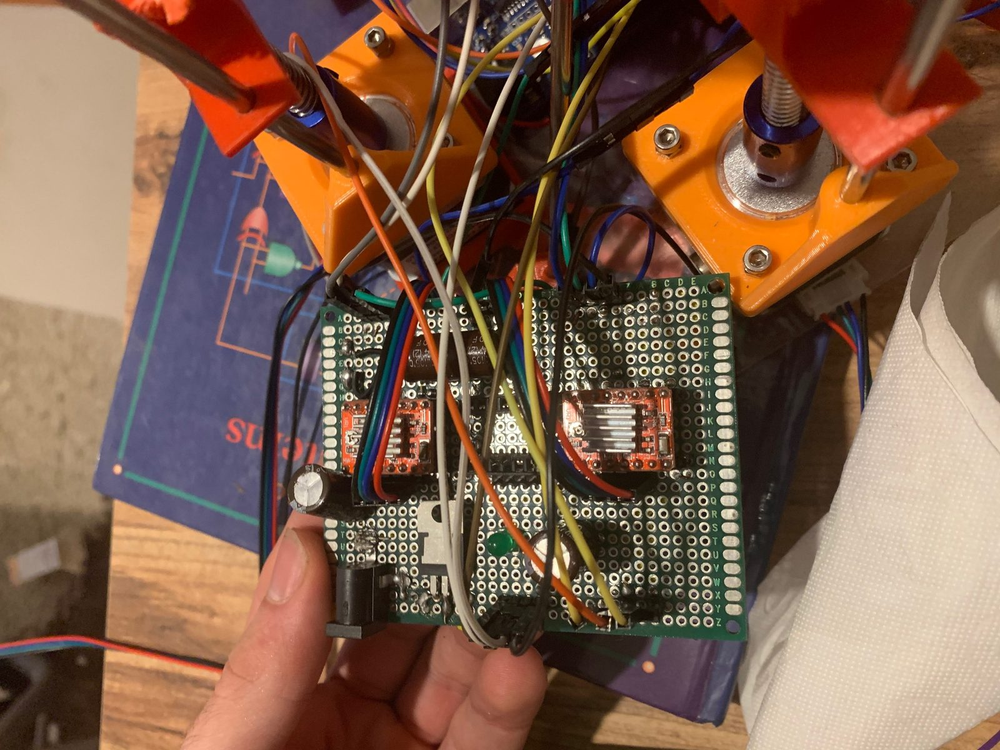
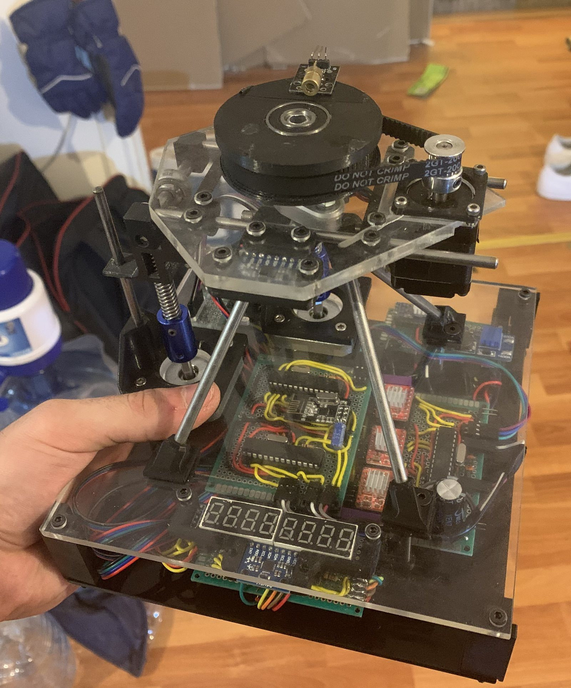

# Electronics

The platform uses five microcontrollers, each with one task. Four are standalone ATmega328 chips with 16 MHz crystals on hand-wired perfboards; the fifth is an Arduino Nano in the handheld remote. No schematic file was drawn for the build, so this page rebuilds the wiring from the pin declarations in the final sketches and from the parts list in [`hardware/BOM.xlsx`](../hardware/BOM.xlsx).

## Pin assignments

Pin numbers are Arduino numbers as written in the sketches (14 to 19 are A0 to A5).

**ATmega328 #1, leveling controller** ([`firmware/MPU6050_DMP6`](../firmware/MPU6050_DMP6/MPU6050_DMP6.ino))

| Signal | Pin |
|---|---|
| MPU6050 SDA, SCL | A4, A5 (I2C) |
| MPU6050 interrupt | D3 (external interrupt 1) |
| Pitch: coarse (Rapid), enable (Check), direction | D12, D16, D17 |
| Roll: coarse (Rapid), enable (Check), direction | D11, D2, D4 |
| Leveling done | D10 |

The controller reads roll and pitch from the MPU6050's on-chip motion processor (DMP). For each axis, the enable line goes high while the error is above 0.03°, the direction line follows the sign of the error, and the coarse line goes low while the error is above 0.25°. The done line goes high when both axes are within 0.03°. The team report (R5, Figure 11) describes the coarse/fine line as the microstep selection on the A4988 drivers.

**ATmega328 #2, step-pulse generator** ([`firmware/steppperNEW`](../firmware/steppperNEW/steppperNEW.ino))

| Signal | Pin |
|---|---|
| Pitch enable and direction in | D2, D3 |
| Roll enable and direction in | D6, D7 |
| Pitch A4988 STEP, DIR out | D19, D18 |
| Roll A4988 STEP, DIR out | D12, D11 |

It turns the enable and direction lines from chip #1 into step pulses with AccelStepper (driver mode, up to 1000 steps/s).

**ATmega328 #3, incline display** ([`firmware/7segment_8digit_MAX`](../firmware/7segment_8digit_MAX/7segment_8digit_MAX.ino))

| Signal | Pin |
|---|---|
| MPU6050 SDA, SCL; interrupt | A4, A5; D3 |
| MAX7219 DIN, CS, CLK | D10, D11, D13 |

It shows the pitch and roll of the base on an 8-digit 7-segment display.

**ATmega328 #4, yaw-stage receiver** ([`firmware/Remote_Reciever_2.4ghz`](../firmware/Remote_Reciever_2.4ghz/Remote_Reciever_2.4ghz.ino))

| Signal | Pin |
|---|---|
| nRF24L01 CE, CSN; SPI | D9, D10; D11 to D13 |
| A4988 STEP, DIR, enable | D2, D7, D8 |

It receives the remote's command (RadioHead reliable datagram, address 2), turns the NEMA 11 by the requested steps and speed, counts the position, and sends the angle back to the remote.

**Arduino Nano, handheld remote** ([`firmware/Remote_Transmitter_2.4ghz`](../firmware/Remote_Transmitter_2.4ghz/Remote_Transmitter_2.4ghz.ino))

| Signal | Pin |
|---|---|
| Joystick X, Y; button | A1, A2; D17 |
| TM1637 CLK, DIO | D4, D5 |
| nRF24L01 CE, CSN; SPI | D7, D6; D11 to D13 |

It reads the joystick and sends a five-character command from address 1 to address 2: the step size (two digits, 1 to 16), the speed (1 to 9), the direction and a select bit. It shows the angle that the platform sends back on the 4-digit display.

## Power and boards

- Platform supply: 12 V, 1.5 A adapter into a 2.1 mm DC jack, with 5 V and 3.3 V step-down regulators. The A4988 drivers carry heatsinks.
- Remote: 3.7 V lithium cell and a step-up converter.
- Final build: three hand-wired perfboards, 2 x 8 cm, 3 x 7 cm and 8 x 6 cm (modelled in the NX assembly). A 7 x 9 cm board carried the first prototype's drivers in April 2020.
- The first radio link was a 433 MHz pair (FS1000A, RadioHead ASK; [`firmware/dev/Remote_transmitter`](../firmware/dev/Remote_transmitter/Remote_transmitter.ino)). The final build uses nRF24L01 modules at 2.4 GHz with acknowledged messages.

## Photos

| | |
|---|---|
|  |  |
| Targeting controller on a breadboard: standalone ATmega328, A4988, 4-digit display (spring 2020). | Incline display: ATmega328, MPU6050 and the 8-digit MAX7219 display. |
|  |  |
| First remote: ATmega328, joystick and the 433 MHz transmitter. | The 2 x 8 cm power-distribution board with the DC jack. |
|  |  |
| Prototype driver board under the printed motor mounts (April 2020). | The finished device (June 2020). |
